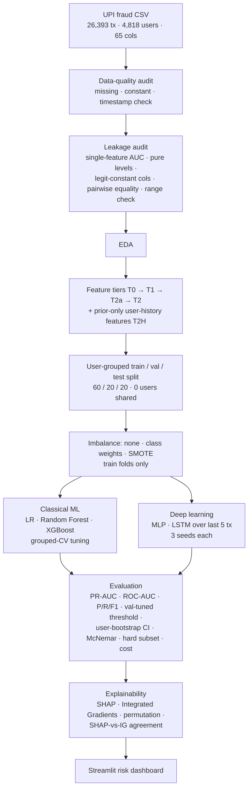

# A Leakage-Aware & Explainable ML + Deep Learning Framework for UPI Fraud Detection

M.Sc. Data Science group project (5 members) · Dataset: [UPI Fraud Detection Dataset — Kaggle (Om Shete)](https://www.kaggle.com/datasets/omsshete/upi-fraud-detection-dataset)

> **Research question.** Can a leakage-aware, explainable framework that combines classical machine learning
> (Logistic Regression, Random Forest, XGBoost) and deep learning (MLP, LSTM) reliably flag potentially
> fraudulent UPI transactions, and how do data leakage, class imbalance, feature design and model choice
> affect detection performance?

All numbers below come from `python run_all.py` on the included CSV. The full results with every table are in
[`reports/RESULTS.md`](reports/RESULTS.md) (auto-generated, nothing typed by hand).

---

## 1. Headline findings

| # | Finding | Evidence |
|---|---|---|
| 1 | **The raw data is fully leaked.** With all 49 usable columns, LR, XGBoost and MLP all reach PR-AUC = 1.000. | Exp 1 |
| 2 | Leakage comes in **three forms**: 3 *label proxies* (`handle_verification_status` alone separates the classes perfectly), 39 *scenario-signature* columns (constant for every legitimate row), and 1 *interaction leak* (two geographic columns identical in every legitimate row, although each column alone has AUC ≈ 0.50). | Audit, Exp 1 |
| 3 | On the 12 strict behavioural features, **XGBoost is the champion**: test PR-AUC **0.953** (95 % user-bootstrap CI 0.943–0.963), precision 0.983, recall 0.879, 15 false alarms. | Exp 2 |
| 4 | **Deep learning is competitive but does not beat boosting on tabular data**: MLP 0.942, LSTM 0.930. McNemar: XGBoost is significantly better than LR, MLP and LSTM (p < 0.05) but **not** significantly different from Random Forest (p = 0.08). | Exp 2 |
| 5 | A transparent **range rule** (flag anything outside the legitimate min/max) already gets precision 0.988 / recall 0.831. On the **hard subset** where no feature is out of range (4,567 test rows, 162 frauds), the best PR-AUC drops to **0.43**. That is the honest measure of what the models learned. | Exp 1, Exp 2 |
| 6 | **Transaction order carries no signal** in this data: LSTM ordered 0.933 ≈ shuffled 0.929; a 1-step LSTM (0.940) beats the 5-step one. User-history features also add nothing. | Exp 4, Exp 6 |
| 7 | **Class weights vs SMOTE barely matter** (≤ 0.01 PR-AUC) once the threshold is tuned on validation; the imbalance (17 % fraud) is moderate. | Exp 3 |
| 8 | **Explanations can act as a leakage detector**: SHAP (XGBoost) and Integrated Gradients (MLP) agree at ρ = 0.47 *with* the leaky geographic pair and ρ = 0.83 *without* it. The interaction leak was first noticed this way. | Exp 7, 7b |

---

## 2. Workflow



### Experiments

| Exp | Question | Compared |
|---|---|---|
| 1 | How much does leakage inflate performance? | T0 all features vs T1 proxies removed vs T2a (+ geo pair) vs T2 strict; LR, XGBoost, MLP, rule baseline |
| 2 | Which model is best after the audit? | Tuned LR, RF, XGBoost vs MLP vs LSTM; bootstrap CI, McNemar, hard subset |
| 3 | Does imbalance handling matter? | none vs class weights vs SMOTE for LR, RF, XGBoost, MLP |
| 4 | Do user-history features help? | T2 vs T2H (+8 prior-only history features) |
| 5 | Does the split strategy matter? | User-grouped vs random row split |
| 6 | Does sequence order carry signal? | MLP (T2, T2H) vs LSTM (length 1, length 5 ordered, length 5 shuffled) |
| 7 | What drives predictions, and do methods agree? | SHAP (XGBoost), Integrated Gradients (MLP), permutation (LSTM); 7b: agreement with vs without the leak |

### Methodological rules
* **Split before fitting anything.** Scalers, encoders and SMOTE are fitted on training rows only (SMOTE lives inside an `imblearn` pipeline).
* **Split by user.** 59 % of users have both fraud and legitimate transactions, so a user never appears in two partitions.
* **Every choice is made on validation**: imbalance strategy, feature set, decision threshold, champion model. The test set is used once.
* **History features use only earlier transactions** (`shift(1)` before every expanding statistic) and never use labels.
* **Deep models are trained with 3 seeds**; mean ± sd is reported.

---

## 3. Project structure

```
upi-fraud-detection/
├── data/
│   ├── raw/fraud_dataset.csv            # Kaggle data (unchanged)
│   └── processed/                       # cached features + shared split indices
├── src/
│   ├── config.py                        # paths, seeds, feature-tier definitions   (all)
│   ├── data_loader.py                   # loading, cleaning, time parsing          (Member 1)
│   ├── leakage_audit.py                 # 5 leakage checks + rule baseline         (Member 1)
│   ├── features.py                      # tiers, history features, preprocessing   (Member 2)
│   ├── splits.py                        # user-grouped split, grouped CV           (Member 2)
│   ├── models_classical.py              # LR / RF / XGBoost + tuning               (Member 3)
│   ├── models_deep.py                   # PyTorch MLP + LSTM, sequence builder     (Member 4)
│   ├── evaluation.py                    # metrics, thresholds, bootstrap, McNemar  (all)
│   ├── explain.py                       # SHAP, Integrated Gradients, permutation  (Member 5)
│   └── plots.py                         # shared figure style
├── notebooks/                           # one executed notebook per member
│   ├── 01_data_audit_and_eda.ipynb
│   ├── 02_features_split_imbalance.ipynb
│   ├── 03_classical_ml.ipynb
│   ├── 04_deep_learning_mlp_lstm.ipynb
│   ├── 05_explainability_and_dashboard.ipynb
│   └── build_notebooks.py               # regenerates the notebooks
├── app/streamlit_app.py                 # fraud-risk dashboard                    (Member 5)
├── models/                              # trained models + thresholds (model_meta.json)
├── reports/
│   ├── RESULTS.md                       # full auto-generated results
│   ├── summary.json
│   ├── figures/                         # 22 report-ready PNGs
│   └── tables/                          # every experiment as CSV
├── run_all.py                           # end-to-end pipeline
├── make_report.py                       # builds reports/RESULTS.md from tables
└── requirements.txt
```

---

## 4. How to run

```bash
# 1. environment (Python 3.10+)
python -m venv .venv && source .venv/bin/activate      # Windows: .venv\Scripts\activate
pip install -r requirements.txt

# 2. full pipeline: audit, EDA, 7 experiments, models, figures (~13 min on a laptop CPU)
python run_all.py            # or: python run_all.py --fast   (~6 min, 1 DL seed)

# 3. results report
python make_report.py        # -> reports/RESULTS.md

# 4. dashboard
streamlit run app/streamlit_app.py

# 5. (optional) re-execute the member notebooks
jupyter nbconvert --to notebook --execute --inplace notebooks/0*.ipynb
```

Trained models, tables and figures are already included, so the dashboard and notebooks work straight after
step 1. Re-running step 2 reproduces them (fixed seeds; small differences can occur across library versions).

### Dashboard pages
Overview · Leakage audit · Model comparison · Deep learning & sequences · **Transaction monitor** (risk score,
alert threshold slider, per-transaction SHAP explanation) · **Threshold & cost** (editable cost assumptions) ·
**Score a transaction** (what-if scoring) · Explainability.

---

## 5. Division of work

| Member | Responsibility | Code | Notebook |
|---|---|---|---|
| 1 | Data quality, leakage audit, EDA, Exp 1 | `data_loader.py`, `leakage_audit.py` | 01 |
| 2 | Feature tiers, history features, split, imbalance (Exp 3–5) | `features.py`, `splits.py` | 02 |
| 3 | LR, RF, XGBoost, tuning, Exp 2, McNemar, threshold and cost | `models_classical.py`, `evaluation.py` | 03 |
| 4 | MLP, LSTM, sequence experiment (Exp 6) | `models_deep.py` | 04 |
| 5 | SHAP, Integrated Gradients, Exp 7/7b, dashboard, integration | `explain.py`, `app/` | 05 |

All members share `config.py`, the split in `data/processed/split_indices.json`, and the evaluation protocol in `evaluation.py`.

---

## 6. Model details

| Model | Configuration |
|---|---|
| Logistic Regression | standardised inputs, L2, `C` tuned (12 log-spaced values), class weights |
| Random Forest | 200–400 trees, depth / leaf size / max_features tuned, balanced-subsample weights |
| XGBoost | `hist` trees; depth, learning rate, n_estimators, min_child_weight, subsampling tuned |
| MLP | 12 → 128 → 64 → 32 → 1, BatchNorm + ReLU + Dropout 0.3, AdamW (lr 1e-3, wd 1e-4), BCE with pos_weight or SMOTE, ReduceLROnPlateau, early stopping on val PR-AUC (patience 10) |
| LSTM | input: the user's last ≤ 5 transactions (oldest → current, packed variable length), 2-layer LSTM (64 units, dropout 0.2); head = [last hidden state ‖ current transaction] → 64 → 1 |

Tuning: `RandomizedSearchCV` (12 iterations) with `StratifiedGroupKFold(5)` on training users, scored on average precision.
Chosen hyper-parameters are stored in `models/model_meta.json`.

---

## 7. Limitations

* **Synthetic data.** Fraud was generated by injecting scenarios with deterministic signatures, so results do not transfer to real UPI traffic.
* **No usable dates.** `timestamp` holds only `MM:SS.f`, so no temporal validation is possible. The LSTM order is an intra-day pseudo-chronology (hour + mm:ss).
* **Range artefacts remain** in the behavioural features; this is quantified through the rule baseline and hard-subset evaluation rather than hidden.
* **The cost analysis is illustrative** (₹100 per alert, ₹1,000 per false alarm; editable in the dashboard).
* **Feature importance shows association, not causation.**
* The dashboard is a research prototype and is not connected to any bank, PSP or NPCI system.

## 8. Future work
Validate on real or more realistic data with true timestamps (temporal split, concept drift); a graph model over
user–merchant–device links; calibrated probabilities (isotonic / Platt) for risk bands; online scoring with drift monitoring.
